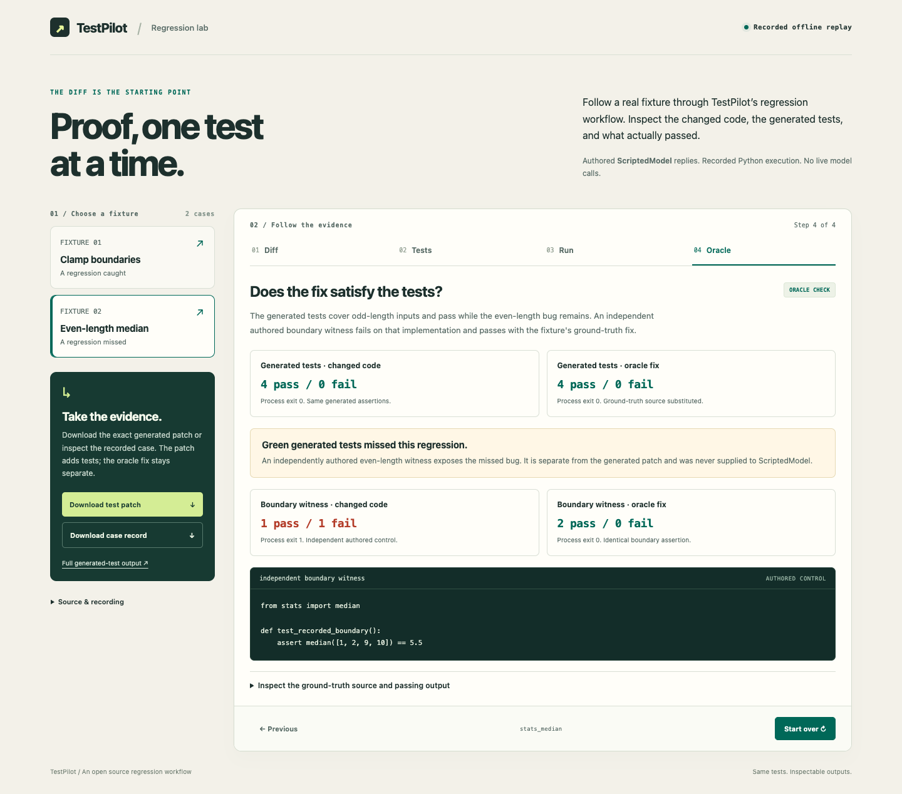
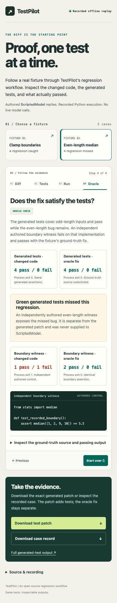

# Independent TestPilot browser receiving

The recorded-run consistency candidate now has a real browser consumer receipt in addition to its authored-DOM regression course. This is independent receiving of the existing source owner's candidate; no product file is changed here.

## Received result

Exact candidate: bfb5cc2830fbe535d705ac2649503e3ae7647224.
Exact original control: 478f68adf01658a94a3ede22526da00f580785bd.
Only app.mjs differs among the 28 runtime inputs. All 27 common inputs match the original source.

On 12 October 2026, Mac.lan / Node v26.11.0 / Chrome 154.0.8037.99 completed **69 checks with zero failures**. Chrome and the receiver process exited 0, and the private ephemeral loopback server closed.

- Both fixtures and all four stages were received at 1440px and 390px, with the actual recorded result and separate oracle witness visible.
- Native Chrome pointer and keyboard input received the skip link, fixture focus, stage arrows, Home/End, precise fixture/stage deep links, and deterministic invalid-link fallback.
- All **12 actual browser downloads**—patch, full case record and complete generated-test log for each case in each viewport—matched the declared byte counts, SHA-256 and suggested filenames. Their retained files were independently read again before publication.
- Three frozen malformed recordings (wrong process exit, missing retained cases, and a failed-process witness with no recorded failure) were visibly admitted by the exact original application. The candidate rejected each before showing a verdict or enabling a download. Reloading original healthy data restored normal use.
- No external page request or page exception was observed. All candidate runtime bytes and the original control app remained unchanged.

The complete raw [receipt](receipt.json), [as-run receiver](receive-browser.mjs), [frozen acceptance contract](receiving-contract.json), and [native publication inventory](artifact-inventory.json) are preserved. Receipt SHA-256: bece35948294667529b1f6f1283ded3edab9b5b4a16a982c2294eeeaa488e619.

## Inspect the received interface

Both actual captures were inspected: readable content, visible outcome distinctions, intact controls, and no page-wide horizontal overflow. The narrow layout moves the download panel after the replay.

## Use and reproduce

To use the static replay from an exact checkout of the candidate, serve its web-demo directory on loopback with Python's standard-library server, then open the printed local address. The existing [user guide](../../../../web-demo/README.md) covers its workflow and recording provenance.

For an independent repeat of this receiver on macOS with Chrome and Node, create a new empty scratch directory, copy only source-payload.json into it, then run the saved receive-browser.mjs with that directory as its first argument. The source payload contains the exact candidate runtime bytes, exact original app, and frozen expectations. The receiver verifies their Git blob identities, creates its own runtime/download/capture directories, starts a private loopback server and disposable browser profile, performs the real journey, writes its receipt, and closes the server/browser.

Use a fresh scratch destination: existing runtime, downloads or captures directories are refused. Keep the published receipt separate from a later rerun. The source payload is 129,708 bytes, SHA-256 318934634ad0a11f5c2fabc53f848f89c6d5bc7bd7de45596c36400c0733c861.

## Boundaries and ownership

This browser replays existing recorded Python/ScriptedModel results; it does not run a fresh Python pipeline or call a live model. Native input here means DevTools Input dispatch, not physical human input. A 390px desktop Chrome viewport does not qualify a physical phone, screen reader or every browser.

Chrome stderr is preserved with its native allocator/display/encryption/registration/pipe diagnostics; no clean-stderr or zero browser-background-network claim is made. The page request boundary allows only the private receiver and data URLs.

The source owner 719c8e1b4e10 retains validator integration and site adoption. This evidence is published on a separate non-main branch with no PR, because the repository workflow triggers every pull request and pushes to main. The original and candidate owner refs are preserved; no Actions, deployment or installed service is claimed.

Native root: /tmp/hamon-testpilot-browser-ccd6f8d6-6rzhdfa4.
Receiver: HAMON delivery_work / ccd6f8d65954.
